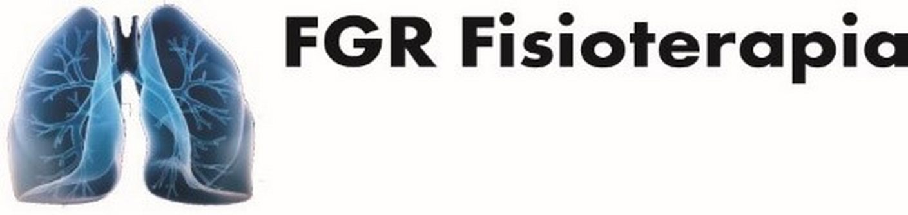

# FGR Fisioterapia — Landing Page

<p align="center">
  
</p>

<p align="center">
  
  
  
  
</p>

Landing page institucional estática da **FGR Fisioterapia LTDA**, empresa de fisioterapia hospitalar e homecare presente em 3 hospitais de São Paulo. O projeto foi construído em um único arquivo HTML, com CSS e JavaScript puros, sem frameworks, sem build e sem qualquer coleta de dados.

## Sobre a empresa

A FGR Fisioterapia LTDA foi fundada em 2020 e está sediada em Poá (SP). A operação reúne gestão rigorosa de escalas e prática clínica baseada em evidências, com atuação em UTI Adulto, UTI Infantil, Enfermaria e Homecare.

- **CNPJ:** 37.542.738/0001-90
- **Sede:** Av. Felício Marinelli, 604 – Jardim Medina, Poá – SP, CEP 08556-200
- **Contato:** fgrfisioterapialtda@gmail.com

## Demo

| Ambiente | URL |
| --- | --- |
| Produção | [fgr-fisioterapia-landing.vercel.app](https://fgr-fisioterapia-landing.vercel.app/) |

## Seções da página

| Seção | Âncora | Conteúdo |
| --- | --- | --- |
| Hero | `#top` | Proposta de valor, CTAs e painel da operação assistencial |
| Quem somos | `#quem-somos` | História da empresa e cards da diretoria |
| Áreas de atuação | `#areas` | UTI Adulto, UTI Infantil, Enfermaria e Homecare |
| Modelos de contrato | `#contratos` | Caminhos para hospitais e para fisioterapeutas PJ |
| Contato direto | `#contato` | E-mail, cópia para a área de transferência e links `mailto:` |
| Rodapé | — | Dados institucionais, diretoria e endereço |

## Stack

- **HTML5** semântico
- **CSS3** com variáveis, Grid, Flexbox, `clamp()` e media queries
- **JavaScript** puro para menu mobile, cópia de e-mail e feedback visual
- **Google Fonts:** Plus Jakarta Sans (400–800)
- **Vercel:** hospedagem estática, sem etapa de build

## Design system

### Paleta

| Token | Cor | Uso |
| --- | --- | --- |
| Fundo | `#F7FAFC` | Fundo geral da página |
| Superfície | `#FFFFFF` | Navbar, cards e footer |
| Borda | `#E2E8F0` | Contornos e divisores |
| Azul marinho | `#0B2239` | Títulos e bloco de contratos |
| Azul clínico | `#0077B6` | CTAs, destaques e ícones |
| Azul hover | `#005B8F` | Estado hover dos CTAs |
| Azul suave | `#E6F3FA` | Badges e destaques leves |
| Azul névoa | `#F0F8FF` | Fundos de apoio |
| Texto | `#111827` | Texto principal |
| Texto secundário | `#64748B` | Parágrafos e legendas |

### Tipografia e formas

- Fonte geométrica **Plus Jakarta Sans**.
- Títulos com `letter-spacing` negativo e alto contraste.
- Cards com bordas arredondadas entre **20px** e **28px**.
- Botões, badges e navbar em formato pílula (`999px`).
- Navbar flutuante com `position: sticky` a `20px` do topo.

## Privacidade

Esta página foi construída para **não coletar e não armazenar dados**:

- Nenhum `<form>`, input de cadastro ou campo de contato.
- Nenhum cookie, `localStorage` ou `sessionStorage`.
- Nenhum back-end ou serviço de analytics.
- Todo contato acontece por links `mailto:` com assunto e corpo pré-preenchidos.
- O único recurso interativo de dados é o botão **Copiar e-mail**, que usa `navigator.clipboard.writeText` e exibe o feedback "Copiado!" por alguns segundos.

## Estrutura

```text
fgr-fisioterapia/
├── index.html
├── assets/
│   └── logo.jpg
├── README.md
├── vercel.json
└── .gitignore
```

## Contato

- **E-mail:** fgrfisioterapialtda@gmail.com
- **Assunto para hospitais:** Proposta hospitalar — FGR Fisioterapia
- **Assunto para fisioterapeutas PJ:** Currículo PJ — Fisioterapeuta | FGR Fisioterapia

## Direitos

Conteúdo institucional da FGR Fisioterapia LTDA. Todos os direitos reservados.
